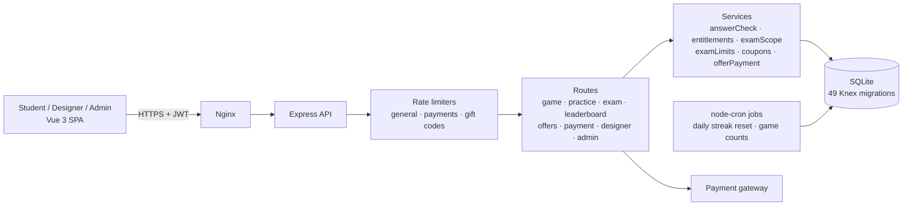
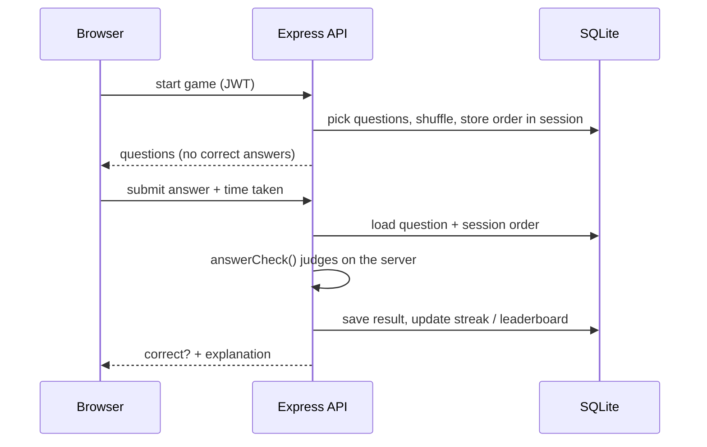

# Elyco — exam-practice platform used for graded coursework

**Live:** [elyco.ir](https://www.elyco.ir) · **Role:** Co-founder & lead (sole) developer · **Built:** Aug 2025 – present
**Stack:** Vue 3 · Vite · Tailwind · Node.js · Express 5 · SQLite (Knex migrations) · Linux VPS · cron · node:test

> The production source code is private because Elyco is a commercial product with paying users.
> This repository is a technical case study. Full source can be walked through on request.

---

## The problem

Students preparing for exams practise with static PDFs: no feedback, no way to see progress, and nothing that makes them come back every day. Teachers and medical-school staff wanted daily, gradable quizzes that students could not game.

## What I built

A full-stack quiz platform in Persian (RTL), from first commit to payments, on my own:

- **Daily games and practice mode:** multiple-choice, word-selection ("provision") and sentence-ordering questions, with hints and explanations.
- **Streaks and leaderboards** to bring students back every day.
- **Exams for organisations:** join codes, exam scopes and limits, so a school or university can run its own graded quizzes.
- **Content tools:** separate designer and inspector roles, so 40+ content designers write and review questions without developer help.
- **Monetisation:** subscription offers, a shop, coupons and gift codes, and an online payment gateway with success/failure callbacks.
- **Admin panel** with usage statistics.

## Results

| Metric | Value |
|---|---|
| Monthly active users | **1,000+** |
| Paying subscribers | **300** |
| Institutional adoption | Pilot with Farzanegan High School, then **Shiraz University of Medical Sciences**, where daily quizzes count towards medical students' grades (Pathophysiology, Haematology & Oncology) |

## Architecture

## Engineering highlights

### 1. Cheating-resistant scoring
Marks count towards university grades, so the client is never trusted:
- **Answers are judged only on the server** (`services/answerCheck`); the browser never receives the correct answer before submitting.
- **Question order is shuffled and stored server-side per session**, so a replayed or reordered session is detected.
- **Role checks** on every designer, inspector and admin route.
- **Rate limiting** keyed by user ID (or IP + user agent when logged out), with tighter limits on payment and gift-code routes, which blocks scripted answering and brute-forcing codes.

### 2. One judging service for every mode
The marking logic for games and Practice mode was duplicated and drifting. I pulled it into one tested service, which also fixed a real bug: the "armor" hint for sentence-ordering had been checking "≤ 1 misplaced word", which can never happen, because any wrong order misplaces at least two words. It now correctly forgives exactly one swapped pair.

### 3. Performance as data grew
I ran weekly performance reviews to find components that stopped scaling as users and questions grew, rewrote them, and added client-side caching to cut gameplay lag.

### 4. Tested and migrated safely
- **68 automated tests** (node:test) cover answer checking, entitlements, exam limits and scope, coupons, offer payments, saved questions and migrations.
- **49 versioned Knex migrations** let the schema evolve under live users without data loss.

## What I learned
- Never trust the client when results matter.
- Shared, tested services beat copy-pasted logic: the armor bug only surfaced once the logic had one home.
- Working with schools and a medical university taught me to turn non-technical requirements into features.

---
Built by **Shayan Hosseini** · [LinkedIn](https://www.linkedin.com/in/shayan--hosseini/) · [GitHub](https://github.com/Shayan-h1383)
